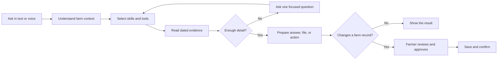
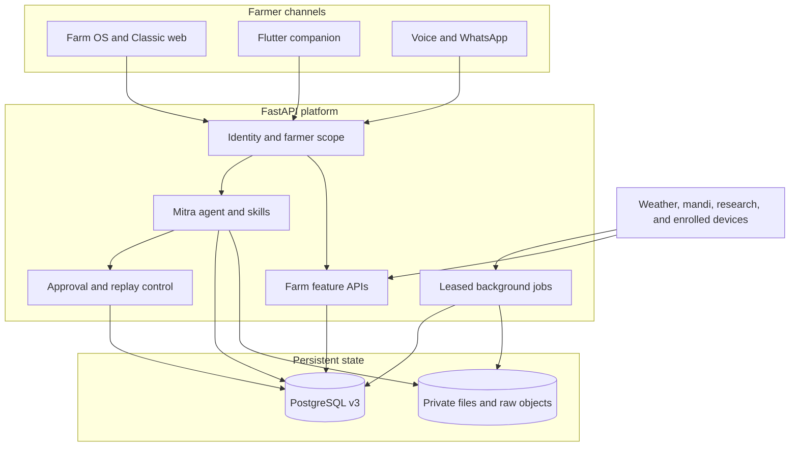

**Ask about your farm in your language. Mitra investigates, prepares the work, and brings the decision back to you.**

Kisan Mitra is an open-source, agentic Farm OS built by **init.io** for the **AI Builder Cup**. Farm records, crop care, weather, mandi markets, planning, and resource exchange meet in one workspace. Mitra investigates, creates files, and drafts actions for approval; the same farm context follows the farmer across the web, voice, and supported messaging channels.

[](LICENSE)  

[Explore the product](#explore-the-farm-os) · [See the agent at work](#one-question-to-a-finished-task) · [Run the project](#get-started) · [Read the architecture](#under-the-hood) · [Contribute](#contributing)

> **The idea:** a farmer should not have to know which screen, form, or tool to open. They should be able to say what needs doing, see how Mitra reached its answer, and approve the result.

## One question to a finished task

> **Farmer:** “Check my work for this week against the weather. Tell me what needs attention first, make a simple checklist, and ask before changing anything.”

Mitra restores the farmer's session and farm context, reads dated tasks and the relevant forecast, then returns a prioritized checklist with the evidence it used. If a task should move, the proposed date and change appear for review. The calendar updates only after approval.



The run is visible in chat: tool activity, focused follow-up questions, inline charts, file previews, and the final result stay with the conversation. Mitra has **22 farm skills** and **52 typed tools** for research and farm work; farmers can use ordinary language rather than tool names.

## Get started

The development stack uses Docker Compose to start PostgreSQL 16, the schema initializer, FastAPI and its worker, and the web client behind Nginx.

```bash
cp .env.docker.example .env.docker
# Set distinct POSTGRES_PASSWORD and V3_APP_PASSWORD values in .env.docker.
docker compose --env-file .env.docker up --build
```

Open **[Farm OS](http://127.0.0.1:5173/workspace)** or **[Classic SkyView](http://127.0.0.1:5173/overview)**. The two interfaces use the same farmer account and records. The [setup guide](docs/local-setup.md) covers native Python and Node development; the [configuration guide](docs/configuration.md) lists server settings. GCP is the deployment target, described [below](#deployment-target).

## Explore the Farm OS

Farm OS is the reimagined workspace. The original SkyView interface remains available for its dashboards and dedicated feature pages. Both are connected to the same backend.

### Understand before acting

| **Assistant that acts** | **A farm you can inspect** |
| --- | --- |
| [](docs/media/assistant-task-preview.png) | [](docs/media/farm-station.png) |
| Ask, investigate, generate, and approve in one conversation. | Explore the Three.js station and inspect dated readings from enrolled devices. |

### Keep the season moving

| **The day ahead** | **The field notebook** |
| --- | --- |
| [](docs/media/farm-calendar.png) | [](docs/media/farm-notebook.png) |
| Review and edit farm tasks in a calendar that understands the work. | Keep crop cycles, field observations, expenses, and plans together. |

### Stay connected to the outside world

| **Farm weather** | **Farmer exchange** |
| --- | --- |
| [](docs/media/farm-weather.png) | [](docs/media/farm-exchange.png) |
| See current conditions, hourly changes, forecast, wind, and air quality. | Describe what you have or need, compare fit, agree terms, and confirm handover. |

The workspace also includes [Crop Doctor](docs/media/farm-crop-doctor.png), [market search and price history](docs/media/farm-markets.png), [farm support](docs/media/farm-support.png), and the [farmer profile](docs/media/farm-profile.png). Open any image above for a full-size view. The [feature guide](docs/features.md) maps each page to its route and data path.

### Saathi: prepared work, ready to review

[](docs/media/saathi-review.png)

Saathi reads the current farm context and prepares useful next moves: crop follow-ups, notebook upkeep, or a fair resource exchange. Each suggestion opens to a preview. The farmer can edit, approve, or dismiss it, and sees confirmation when the approved change is saved.

### An assistant that can return more than text

| Need | What appears in chat |
| --- | --- |
| **A plan or record change** | A dated, reviewable action with approval before the write. |
| **A missing detail** | One focused input card; the task continues after the answer. |
| **A market or weather comparison** | A dated chart with its source and time context. |
| **A report or working file** | DOCX, PDF, XLSX, CSV, or PPTX with an inline preview and private download. |
| **A different language** | The original question and answer in the farmer's language or script where supported. |
| **A return visit** | Conversation history and bounded memory of preferences, corrections, and relevant facts. |

See a [Hindi conversation](docs/media/assistant-hindi.png), [chart inside chat](docs/media/assistant-weather-chart.png), [generated file preview](docs/media/assistant-file-preview.png), and the [inspectable toolkit](docs/media/assistant-toolkit-detail.png). The [assistant guide](docs/assistant.md) describes its execution lifecycle, memory, approvals, and artifacts.

## What farmers can do

| Farm work | Experience |
| --- | --- |
| **Know the farm** | Profile, plots, crops, equipment, notes, calendar, and an interactive station. |
| **Care for crops** | Photo-led Crop Doctor, symptoms, follow-up steps, and crop planning. |
| **Plan around conditions** | Location-aware weather, rainfall outlook, and dated field work. |
| **Understand markets** | Search crops, states, mandis, varieties, grades, units, and dated prices. |
| **Find support** | Discover source-linked schemes and prepare application checklists. |
| **Work together** | Share equipment, labour, transport, and resources through guided exchange. |
| **Take the result away** | Export records and receive private documents, sheets, charts, and reports. |
| **Talk naturally** | Text, speech input, spoken replies, live voice turns, and supported WhatsApp media. |

## Under the hood

Kisan Mitra is one product across **Farm OS**, **Classic SkyView**, and the Flutter companion. The React and TypeScript web client uses Vite, React Three Fiber, and an owner-scoped read cache. FastAPI hosts the agent and feature APIs. PostgreSQL stores farmer records, conversation state, source releases, approvals, job leases, and audit data. Generated files and raw payloads have private storage paths and database metadata.



### Agent runtime

| Layer | Implementation |
| --- | --- |
| **Plan and execute** | [Bounded engine](skyview/assistant/engine.py), [execution contract](skyview/assistant/execution_contract.py), and visible task progress. |
| **Choose capabilities** | [22 skills](skyview/assistant/skills/) and [52 typed tools](skyview/assistant/tools.py) with validated arguments and read/write separation. |
| **Route model calls** | [Provider routing](skyview/assistant/provider.py) with configured Groq key rotation, cooldowns, and a Gemini fallback. |
| **Remember what matters** | [Conversation memory](skyview/assistant/memory.py) and [fact memory](skyview/assistant/memory_facts.py) with bounded context. |
| **Create and review** | [Artifacts](skyview/assistant/artifacts.py), [approval receipts](skyview/assistant/), and [Saathi plans](skyview/assistant/companion_plans.py). |

### Data and background work

The [v3 data platform](data_platform/v3/) defines schema migrations, constraints, row policies, partitions, indexes, provider catalogs, source releases, and ingestion jobs. Market and station reads have stored database functions; other feature repositories use parameterized SQL inside owner-scoped transactions. Provider origin, observation time, and retrieval time remain distinct.

The [browser cache](frontend/src/lib/ultraCache.ts) deduplicates reads and warms likely routes after login. The [worker](skyview/data/v3/worker.py) uses a PostgreSQL advisory lease so recurring jobs do not run twice across API processes. Requests and retries are bounded; source freshness and failures remain visible instead of silently becoming current data. The [data model](docs/data-model.md), [connector contracts](data_platform/v3/CONNECTORS.md), and [operations guide](data_platform/v3/OPERATIONS.md) document the full path.

### Boundaries that matter

- Farmer sessions bind reads and writes to an owner; PostgreSQL row policies add a second boundary.
- A proposed record change is shown before approval, validated on write, and protected against replay.
- Market prices, weather, farm entries, and device measurements retain their dates and source context.
- Uploads and generated files have type, size, ownership, and private-storage checks.
- Enrolled stations verify credentials, units, timestamps, and packet replay. The [hardware guide](docs/hardware/README.md) covers commissioning and the optional FPGA register bridge.

## Deployment target

The application is being prepared for **Google Cloud Platform**. Its target topology separates the HTTPS web experience, Cloud Run API, Cloud SQL for PostgreSQL, private Cloud Storage, scheduled background work, and runtime secrets. The repository currently provides the containerized application and configuration contracts; the GCP infrastructure and release workflow are the next deployment milestone. See the [hosted deployment requirements](docs/operations.md#hosted-deployment-handoff) before that cutover.

## Project layout

| Path | Owns |
| --- | --- |
| [`frontend/`](frontend/) | Farm OS, Classic screens, 3D station, chat, voice, and read cache |
| [`skyview/assistant/`](skyview/assistant/) | Agent, skills, tools, memory, approvals, artifacts, and channels |
| [`skyview/api/`](skyview/api/) | Feature, market, weather, exchange, and voice routes |
| [`skyview/data/v3/`](skyview/data/v3/) | Repositories, source ingestion, and leased jobs |
| [`data_platform/v3/`](data_platform/v3/) | PostgreSQL schema, migrations, catalogs, and bootstrap |
| [`hardware/`](hardware/) | Device, RTL, HLS, register maps, and verification source |
| [`mobile/`](mobile/) | Flutter companion |
| [`infra/`](infra/) | Container images and Nginx |
| [`tests/`](tests/) | Backend and database contracts |
| [`docs/`](docs/) | Feature, API, data, operations, and hardware guides |

## Contributing

Start with [CONTRIBUTING.md](CONTRIBUTING.md), then the [architecture guide](docs/architecture.md) and [project map](docs/project-map.md). Changes to agent tools, source ingestion, or farm writes should preserve farmer ownership, source context, bounded execution, and reviewable actions.

Kisan Mitra is released under the [MIT License](LICENSE). Built by **init.io** for the **AI Builder Cup**.
