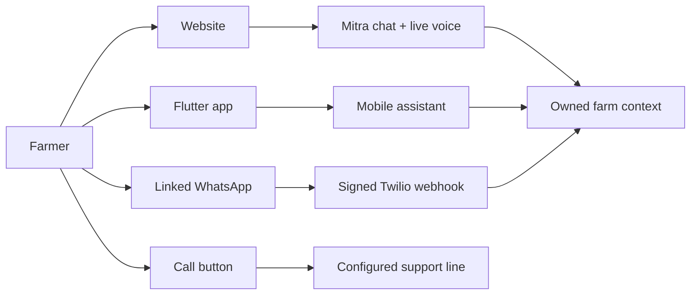
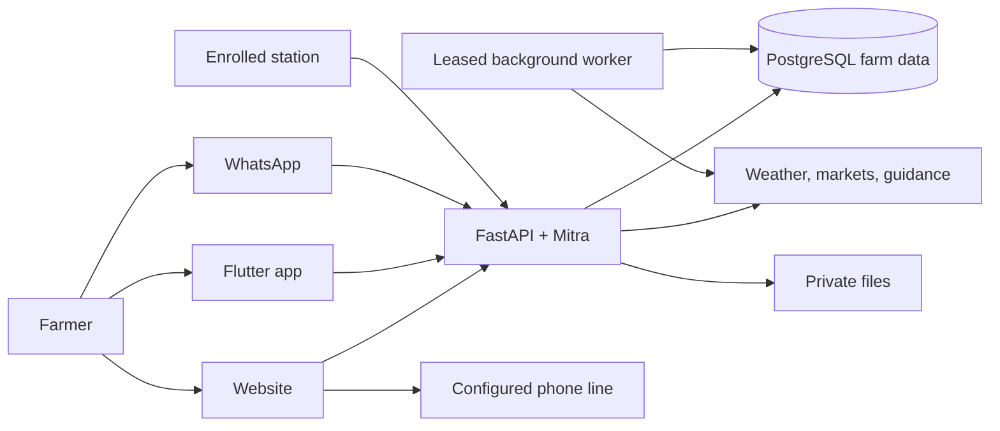
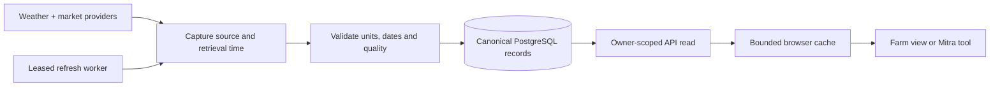
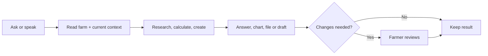
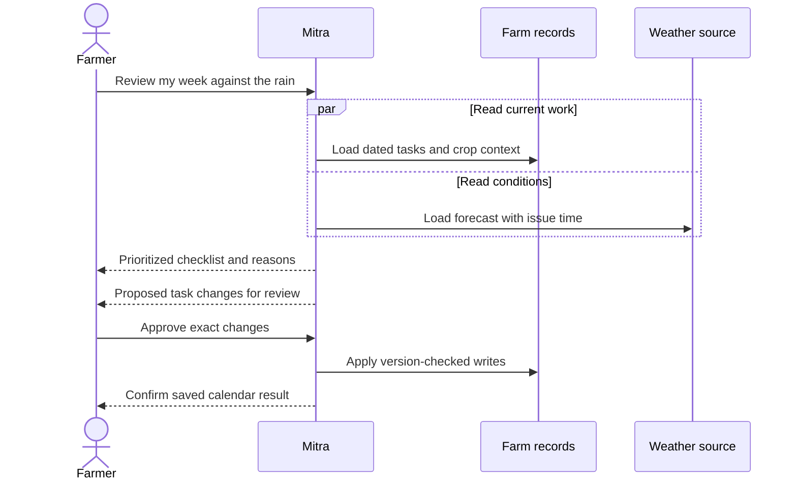
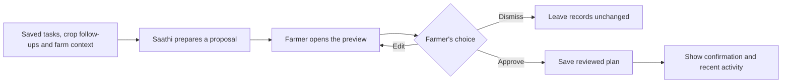
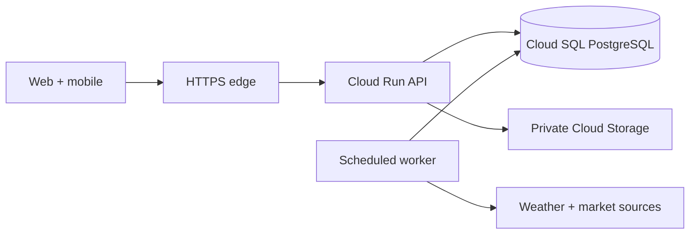

### **An agentic Farm OS that turns a farmer's question into finished work**

*Ask in your language. See the evidence. Review the action. Find the result in your farm.*

---

[](https://github.com/vvinayakkk/kisan-mitra-farm-os)
[](frontend/)
[](mobile/)
[](docs/api/websocket-and-webhooks.md)
[](LICENSE)

**Kisan Mitra**, built by **init.io** for the **AI Builder Cup**, brings farm records, crop care, weather, mandi markets, planning, documents and farmer exchange into one connected experience. Farmers can work through the website, the Flutter companion, a configured WhatsApp channel or the website's call control. Mitra understands ordinary language, investigates with tools, prepares useful work and brings changes back for review.

> **A question is the beginning of a workflow, not the end of a chat.** Ask what needs doing; Mitra finds the relevant farm context, shows its work, asks for missing details and returns an answer, chart, file or action ready to approve.

---

## ⚡ Platform at a Glance

| Capability | What is in the repository | Why it matters |
| :--- | :--- | :--- |
| **Four ways to connect** | Website, Flutter app, configured WhatsApp channel and web call control | Reach farm help through the interface at hand |
| **Two web experiences** | Farm OS workspace and Classic SkyView | A conversational workspace alongside dedicated dashboards |
| **22 farm skills** | Versioned workflows in [the assistant skill catalog](skyview/assistant/skills/) | The agent can plan, research, calculate and prepare work |
| **52 typed tools** | Validated tool contracts in [the assistant runtime](skyview/assistant/tools.py) | Read farm context and carry out reviewed software actions |
| **Ten Farm OS views** | Assistant, calendar, station, weather, crops, markets, support, notebook, exchange and profile | Every major farm need has a focused home |
| **One farmer context** | Owner-scoped records, conversations, files and approvals | The result of a conversation appears in the right farm |

The counts describe the current code and catalog. They are not latency or production-scale claims.

---

## 🗺️ Table of Contents

- [Overview & Vision](#-overview--vision)
- [System Architecture](#-system-architecture)
- [UltraCache & Background Data](#-ultracache--background-data)
- [Backend Execution & Data Integrity](#-backend-execution--data-integrity)
- [Farm OS Design System](#-farm-os-design-system)
- [Verification & Quality](#-verification--quality)
- [Autonomous Agentic Workflows](#-autonomous-agentic-workflows)
- [Core Functional Engines](#-core-functional-engines)
- [Monorepo Directory Structure](#-monorepo-directory-structure)
- [Quick Start & Development](#-quick-start--development)
- [OpenAPI REST Endpoints](#-openapi-rest-endpoints)
- [GCP Deployment Blueprint](#-gcp-deployment-blueprint)
- [License & Open Source Dedication](#-license--open-source-dedication)

---

## 🌍 Overview & Vision

A farmer should be able to describe a problem in their own words without first choosing a dashboard, tool or form. Kisan Mitra connects five parts of that work:

1. **Understand the farm:** Profile, farms, plots, crop cycles, equipment, readings, notes, expenses and upcoming tasks form a usable working context.
2. **Look beyond the farm:** Weather, mandi prices, crop guidance and scheme references carry dates and source context into a decision.
3. **Prepare the work:** Mitra can research, compare, calculate, create plans and generate Word, PDF, spreadsheet, CSV and presentation files.
4. **Keep the farmer in control:** Focused questions resolve missing details. Record changes, exchange terms and prepared plans are reviewable before they are saved.
5. **Meet farmers where they are:** The same product has a web workspace, the original Classic interface, a Flutter companion, linked WhatsApp and a call control.

### Four ways to use Kisan Mitra

| Access | Farmer experience | Integration boundary |
| :--- | :--- | :--- |
| **Website** | Chat, calendar, weather, Crop Doctor, mandi research, notebook, exchange, profile and the 3D station | Farm OS and Classic share the backend and farmer records |
| **Flutter app** | A pocket-sized assistant with feature chips, calendar, station, weather, crops, markets, notebook, exchange, Saathi and profile | Connects to the same API with configured account access |
| **WhatsApp** | Send text, a crop image, voice note or supported document; receive answers and supported files through a linked account | Requires Twilio credentials, signed callbacks and a public HTTPS origin |
| **Phone** | Tap the website's call control to reach the configured voice support number | The dial action depends on the configured line; browser live voice uses the Mitra API |

Farmers can type or speak naturally in supported languages, including Hinglish. The assistant keeps the original-language question and uses the farmer's selected language and conversation context when answering. Speech recognition and synthesis depend on configured services.



The three digital assistant routes reach Mitra through account- or session-bound access. The call button opens the device dialer for a configured support line; it does not imply that a phone conversation is already connected to the agent runtime.

---

## 🏗️ System Architecture

The whole system fits in one picture:



**One account, two web modes.** Farm OS lives at `/workspace`; Classic SkyView keeps its overview, advisor, dashboards, crop care, mandi, marketplace, maps and reporting pages. Both read the same canonical farm data in v3 mode. [The architecture guide](docs/architecture.md) explains the identity, database, worker and device boundaries in detail.

**One agent, several surfaces.** The website, app and configured WhatsApp channel use the Mitra service. The website's phone button dials a configured line; it is separate from browser live voice unless a telephony integration is provisioned.

---

## ⚡ UltraCache & Background Data

Speed matters most when a farmer moves between tasks. The [browser cache](frontend/src/lib/ultraCache.ts) deduplicates owner-scoped reads, warms likely routes after login and invalidates relevant entries after writes or a session switch. Protected server responses remain `no-store`; the cache improves navigation without becoming the record of truth.

The [background worker](skyview/data/v3/worker.py) uses a PostgreSQL advisory lease to coordinate recurring jobs across API processes. Source calls have bounded requests, retries and backoff. Provider payloads retain observation and retrieval metadata; source-health records distinguish a delayed update from a current observation. The [data platform](data_platform/v3/) defines schema evolution, provider catalogs, ingestion and read functions.



An answer can distinguish a current observation, a historical record and a forecast. A failed refresh stays visible in source health instead of becoming an invented zero reading.

| Layer | Responsibility |
| :--- | :--- |
| **Client read cache** | Keep navigation responsive and avoid duplicate reads |
| **FastAPI routes** | Validate identity, parameters, time context and response shapes |
| **PostgreSQL** | Persist owned farm data, conversations, approvals, source records and job state |
| **Leased worker** | Refresh external data and prepare background work without duplicate runs |
| **Private file storage** | Hold generated documents and uploads with owner-scoped metadata |

See [data model](docs/data-model.md), [source connectors](data_platform/v3/CONNECTORS.md) and [operations](docs/operations.md).

---

## 🏎️ Backend Execution & Data Integrity

Mitra's runtime is a bounded task engine, not an unbounded loop. It restores the relevant conversation and farm context, chooses typed tools, streams public activity, and pauses for a focused question or an exact approval when needed. The [execution contract](skyview/assistant/execution_contract.py) and [assistant guide](docs/assistant.md) describe how a paused run resumes without guessing at the farmer's intent.

- **Farmer ownership:** Server-resolved identity, transaction scope and PostgreSQL row policies protect private records.
- **Dated evidence:** Market observations, forecasts, station measurements and farm entries keep their own dates and origins.
- **Reviewable writes:** A proposed change carries exact arguments; version checks and execution receipts prevent stale or repeated application.
- **Controlled media:** Uploads, previews and downloads have type, size and ownership checks. Generated files keep metadata and checksums.
- **Device integrity:** Enrolled stations validate credentials, units, timestamps and replay before readings enter the farm record.
- **Provider routing:** Configured model keys have cooldown and fallback behavior; source and model failures are surfaced rather than hidden.

The database also supports market and station reads through stored functions. Read-only research is distinct from farm-changing actions; an answer does not silently publish an exchange offer, send a message or control equipment.

---

## 🎨 Farm OS Design System

The website has **two deliberate experiences**. Classic SkyView keeps dense dashboards and dedicated tools. Farm OS turns the same capabilities into a quieter, task-led workspace with a feature dock, contextual Mitra helpers and Saathi's prepared work. On mobile, the interface keeps the app's feature chips and adapts conversation, review and calendar flows to a smaller screen.

| **The assistant workspace** | **The farm at a glance** |
| :--- | :--- |
| [](docs/media/assistant-tool-activity.png) | [](docs/media/farm-station.png) |
| Ask in ordinary language; inspect steps and the resulting work. | Explore the Three.js station without losing the practical readings. |

The visual language uses a warm, light farm palette, clear dark text, restrained borders, compact controls and page-aware help. The station gives equipment feedback on interaction; the notebook takes the form of a page-turning field journal; the exchange shows a resource journey instead of a wall of forms. Controls remain labeled and keyboard reachable, with reduced-motion handling for transitions.

---

## 🛡️ Verification & Quality

The repository includes backend and database tests, frontend type checks and component tests, and Flutter analysis and tests. Run them against the correct development services and a **dedicated test database**:

```bash
# Backend: first prepare a separate test database as described in docs/local-setup.md
.venv/bin/python data_platform/v3/test_backend.py

# Frontend
cd frontend
npx tsc --noEmit -p tsconfig.app.json
npx vitest run
npm run build

# Mobile, with the Flutter SDK installed
cd ../mobile
flutter analyze
flutter test
```

The [setup guide](docs/local-setup.md) gives database preparation and native development steps. [Contributing](CONTRIBUTING.md) covers expectations for source provenance, owned data and reviewed changes. This repository does not claim a hosted build or release pipeline.

---

## ⚡ Autonomous Agentic Workflows

The farmer does not need to name a skill. “What should I do before the rain?”, “Compare rice prices near me,” or “Make a weekly plan and ask me anything missing” can each involve several tools, a question, a chart, a document or a proposed calendar change.

### What makes the assistant agentic

**Mitra works toward an outcome across several steps.** It restores the farmer's conversation and saved context, chooses relevant skill instructions and typed tools, reads farm and public evidence, then decides whether it has enough information to continue. It can ask for one missing detail, perform more reads, calculate a result, create an artifact, or prepare a change for review. The farmer sees public activity during the run and can revisit the finished work in history.

| Capability | How it appears in a real farm task |
| :--- | :--- |
| **Contextual planning** | “Plan my week” starts with the farmer's crops, dated tasks and weather instead of a blank checklist. |
| **Tool use** | Mitra can read a station snapshot, compare mandi observations, search public guidance and calculate a budget in one request. |
| **Focused clarification** | If a crop stage or target date is missing, it asks for that detail and resumes the same task. |
| **Evidence-aware synthesis** | The answer carries relevant dates, units, market or provider context, and uncertainty. |
| **Real outputs** | A task can return an inline chart, a downloadable document, a spreadsheet, a presentation or a proposed record change. |
| **Guarded execution** | The exact proposed write pauses for farmer review; approval resumes that saved action with replay and version protection. |
| **Persistent continuity** | Conversation history, bounded memory and owned files preserve useful facts and unfinished work for a later visit. |
| **Proactive assistance** | Saathi prepares contextual follow-ups for the farmer to preview, edit, approve or dismiss. |



For example, “Check this week's work against the rain, make a checklist and move anything risky” is one request with several stages:



The diagram shows the execution boundary: Mitra may prepare an answer and a proposal on its own, but a farm-changing write waits for explicit review. A public source or uploaded document cannot grant that approval.

| Step | What a farmer sees |
| :--- | :--- |
| **Understanding** | The request remains in the language used by the farmer. |
| **Working** | Public tool activity and relevant evidence appear during the run. |
| **Clarifying** | One focused question appears at a time, then the task continues. |
| **Delivering** | A chart, file preview, plan or action card accompanies the answer. |
| **Reviewing** | The farmer approves, edits or declines the exact proposed change. |
| **Returning** | History, bounded memory and saved results make the next visit useful. |

| **A reviewed task** | **A generated file in chat** |
| :--- | :--- |
| [](docs/media/assistant-task-preview.png) | [](docs/media/assistant-file-preview.png) |

| **Language stays in the conversation** | **Skills explain themselves** |
| :--- | :--- |
| [](docs/media/assistant-hindi.png) | [](docs/media/assistant-toolkit-detail.png) |

### The 22 farm skills

| Skill | What it helps do | Skill | What it helps do |
| :--- | :--- | :--- | :--- |
| **Web research** | Find current public guidance with sources | **Farmer exchange** | Compare resources and exchange progress |
| **Field check** | Review station readings and next checks | **Weather outlook** | Read forecast and climate history |
| **Irrigation** | Plan water work around crop context | **Crop calendar** | Turn stage and dates into farm tasks |
| **Market prices** | Compare dated mandi records | **Farm budget** | Calculate costs from real quantities |
| **Scheme checklist** | Prepare benefit application steps | **Crop scouting** | Turn symptoms into an inspection plan |
| **Daily workspace** | Prioritize today's farm work | **Sale planning** | Estimate take-home value after costs |
| **Soil report review** | Explain results without losing units | **Insurance pack** | Assemble dated loss evidence |
| **Expert handoff** | Prepare a crop case for official help | **Crop follow-up** | Maintain observations and next checks |
| **Shared work** | Plan household or FPO tasks | **Service plan** | Record labour, machinery and transport |
| **Farm records** | Maintain tasks and expenses | **Documents** | Create Word and PDF reports |
| **Spreadsheets** | Create Excel workbooks and CSV files | **Presentations** | Build a farm or cooperative deck |

The current catalog is exposed at `GET /api/assistant/catalog`; the [assistant guide](docs/assistant.md) documents the lifecycle, memory, approvals and tool inventory.

---

## 🔬 Core Functional Engines

Every feature has a short job description here. The images are clickable for a full-size view.

### 1. 🧠 Mitra: Conversational Farm Work

**Ask a natural-language question and leave with something useful.** Mitra can investigate, plan, make a file, ask for missing details, stream tool activity and prepare a reviewed change. History reopens earlier work; answer actions allow copying, sharing, feedback, listening and retrying. Compact helpers bring the same context into individual pages.

### 2. 🗓️ Farm Calendar & Seasonal Planning

**Turn farm intentions into dated work.** Create, edit, complete and remove tasks; use crop stage, weather and available labour to prepare a weekly or seasonal checklist. Mitra can propose a change, and the farmer reviews it before it appears on the calendar.

[](docs/media/farm-calendar.png)

### 3. 📓 Farm Notebook, Fields & Money

**Keep the season's work in one field journal.** The notebook connects farms, plots, crop cycles, observations, expense entries, follow-ups, plans and files. It also supports soil-report review, insurance evidence, expert handoff, shared work and service arrangements.

[](docs/media/farm-notebook.png)

### 4. 🩺 Crop Doctor & Follow-up

**Use a crop image and symptoms to decide what to inspect next.** Crop Doctor prepares an assessment with uncertainty, practical checks and a case timeline; subsequent observations stay with the same crop concern.

[](docs/media/farm-crop-doctor.png)

### 5. 🌦️ Farm Weather & City Outlooks

**Read current conditions in the context of farm work.** Current and hourly conditions, rainfall, wind, air quality, outlook and other-city views help decide when to inspect, irrigate, spray or harvest. Weather history and forecast retain distinct time context.

| **Weather workspace** | **Weather evidence inside chat** |
| :--- | :--- |
| [](docs/media/farm-weather.png) | [](docs/media/assistant-weather-chart.png) |

### 6. 📈 Mandi Directory, Rates & Sale Planning

**Find a relevant market before deciding where to sell.** Search by crop, state, mandi and variety; inspect dated rates and historical charts; compare likely take-home value after transport and other costs. Market directory entries, observations and planning calculations are kept distinct.

[](docs/media/farm-markets.png)

### 7. 🏛️ Farm Support & Schemes

**Find benefits and prepare the next application step.** Source-linked scheme references, eligibility context, requirements and a saved support checklist help a farmer move from discovery to preparation.

[](docs/media/farm-support.png)

### 8. 🤝 Farmer Exchange & Resource Routing

**Share a resource or find a fair exchange.** Farmers can describe what they have or need, inspect matches, discuss terms, track an agreement and confirm handover. The Classic marketplace keeps farmer discovery, geographic view, pooling and matching screens available.

[](docs/media/farm-exchange.png)

### 9. 🛰️ 3D Farm Station & Connected Hardware

**See farm equipment and readings in a single visual station.** The Three.js scene makes sensors and tools explorable; enrolled devices contribute dated measurements and health. Hardware setup, packet verification and an optional FPGA register bridge live in [the hardware guide](docs/hardware/README.md).

### 10. ✨ Saathi: Prepared Work to Review

**Let the farm companion prepare useful next moves.** Saathi considers current farm context and offers compact previews for crop follow-ups, notebook upkeep and exchange planning. A farmer can open, edit, approve or dismiss each proposal; saved work appears in the relevant area.

| **Saathi in the workspace** | **A plan ready for approval** |
| :--- | :--- |
| [](docs/media/saathi-review.png) | [](docs/media/saathi-approval.png) |



### 11. 👤 Farmer Profile & Farm Context

**Keep identity, location, language, farms, plots and crop cycles together.** The profile makes advice, weather, tasks and records relevant to the right person and field.

[](docs/media/farm-profile.png)

### 12. 🎙️ Voice, WhatsApp & Files

**Choose the form that fits the moment.** The browser supports voice input and spoken responses when configured. WhatsApp can receive text, crop photos, voice notes and supported documents through a linked account. Mitra can create DOCX, PDF, XLSX, CSV and PPTX outputs, preview them in chat and provide private downloads. The web call button dials a configured support number.

### 13. 🧭 Classic SkyView & Developer Views

**Keep dedicated screens for deeper inspection.** Classic routes retain overview, advisor, dashboard, Crop Doctor, mandi, trends, marketplace, map, reports, profile, accelerator and database views. Hardware setup and procurement pages are also available. The switch into Farm OS keeps farmers in the same account and data context.

---

## 📁 Monorepo Directory Structure

```text
kisan-mitra-farm-os/
├── frontend/             React, TypeScript, Farm OS, Classic and Three.js
├── mobile/               Flutter companion
├── skyview/
│   ├── assistant/        Agent, skills, tools, memory, files and approvals
│   ├── api/              Farm, market, weather, exchange, voice and channel routes
│   └── data/v3/          Repositories, ingestion and recurring worker
├── data_platform/v3/     PostgreSQL schema, migrations and provider contracts
├── hardware/             Device source, RTL, HLS and register maps
├── infra/                Container images, requirements and Nginx
├── tests/                Backend and data contracts
├── docs/                 Product, API, operations, data and hardware guides
└── docker-compose.yml    Development stack
```

Start with the [project map](docs/project-map.md) if you are changing code, and the [architecture guide](docs/architecture.md) for data flow and ownership.

---

## 🚀 Quick Start & Development

### Prerequisites

Docker and Docker Compose are the shortest route to the full web stack. Native development additionally uses Python 3.12 and Node.js 20+. Flutter SDK is required for the mobile target.

### 1. Start PostgreSQL, API, worker and web client

```bash
cp .env.docker.example .env.docker
# Set distinct POSTGRES_PASSWORD and V3_APP_PASSWORD values in .env.docker.
docker compose --env-file .env.docker up --build
```

### 2. Open the two web experiences

- **Farm OS:** [http://127.0.0.1:5173/workspace](http://127.0.0.1:5173/workspace)
- **Classic SkyView:** [http://127.0.0.1:5173/overview](http://127.0.0.1:5173/overview)
- **API health:** [http://127.0.0.1:8001/health](http://127.0.0.1:8001/health)

### 3. Configure optional channels

AI providers, speech, public data connectors and Twilio require server-side credentials. Keep secrets in ignored environment files or a managed secret store. The [configuration guide](docs/configuration.md), [operations guide](docs/operations.md) and [mobile guide](docs/mobile/README.md) explain their settings. No credential belongs in a `VITE_` variable or packaged Flutter define.

For separate Python and Node processes, follow [local operation](docs/local-setup.md). The Docker volumes preserve data across ordinary restarts.

---

## 📡 OpenAPI REST Endpoints

The running FastAPI service exposes `/docs` and `/openapi.json`. These are representative route groups; the [endpoint inventory](docs/api/endpoints.md) lists the registered canonical paths and [API overview](docs/api/overview.md) explains identity and scope.

| Area | Representative path | Purpose |
| :--- | :--- | :--- |
| **Readiness** | `GET /health` | API and database health |
| **Source state** | `GET /api/data/status` | Data mode and source health |
| **Assistant** | `POST /api/assistant/sessions` | Open an owner-scoped conversation |
| **Assistant run** | `POST /api/assistant/sessions/{sid}/run` | Stream a task and its visible activity |
| **Capabilities** | `GET /api/assistant/catalog` | Inspect available tools and skills |
| **Weather** | `GET /api/weather/dashboard` | Current farm weather and outlook |
| **Markets** | `GET /api/mandi/history` | Dated mandi price history |
| **Station** | `GET /api/sensors/latest/{station_id}` | Latest enrolled-device reading |
| **Saathi** | `GET /api/companion/proposals` | Prepared work for review |
| **WhatsApp** | `POST /webhook/whatsapp` | Signed inbound channel callback |

Private endpoints require verified account or assistant-session access; client-supplied identifiers cannot select another farmer's records.

---

## 📦 GCP Deployment Blueprint

**Google Cloud Platform is the intended hosting target.** The [operations guide](docs/operations.md#hosted-deployment-handoff) records what a deployment must provide:



The deployment needs verified account identity, managed secrets, persistent file bytes, database and file backups, a separately scheduled worker, and public HTTPS callbacks for enabled messaging. A container build alone does not provision those services. The frontend and backend images are in [infra](infra/); this repository does not include a cloud release workflow yet.

---

## 📄 License & Open Source Dedication

Kisan Mitra is built by **init.io** for the **AI Builder Cup** and released under the [MIT License](LICENSE). Contributions are welcome: read [CONTRIBUTING.md](CONTRIBUTING.md), then explore the [feature guide](docs/features.md), [assistant guide](docs/assistant.md) and [project map](docs/project-map.md).

**Build for the farmer's next useful action.**
