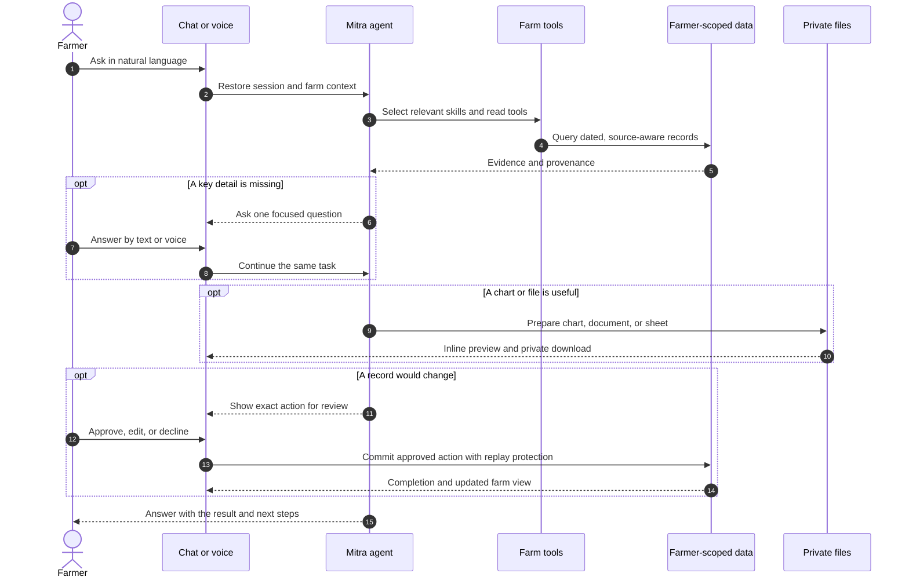
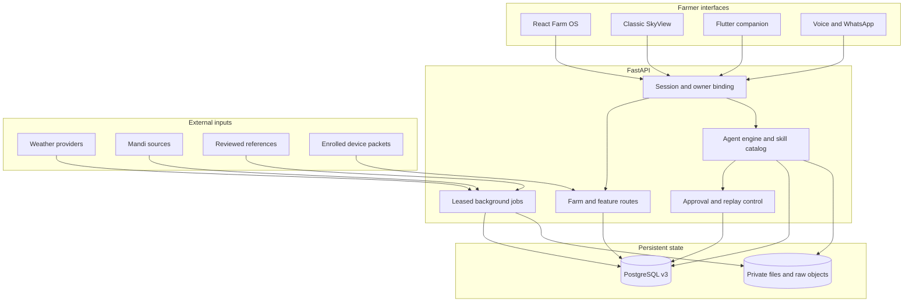
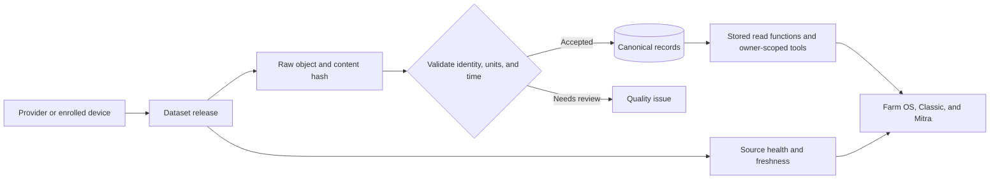

# Kisan Mitra

### An agentic Farm OS that turns a farmer's question into finished work

**Ask in your language. See the evidence. Review the action. Find the result in your farm.**

Built by **init.io** for the **AI Builder Cup** · [MIT licensed](LICENSE)

[Explore the workspace](#the-farm-os-experience) · [Follow an agent run](#how-mitra-gets-work-done) · [Understand the architecture](#architecture) · [See the deployment model](#deployment-model)


Kisan Mitra brings farm records, crop care, weather, markets, planning, and farmer exchange into one conversational workspace. A farmer can ask a natural question, speak it, attach evidence, or start from a page-specific helper. Mitra gathers relevant context, shows its work as it runs, asks for the one detail it needs, and prepares a useful result. Plans and record changes can be reviewed before they are saved. **Saathi** prepares contextual follow-ups for the farmer to inspect, edit, approve, or dismiss.

The platform combines a React and Three.js web app, a FastAPI agent and farm API, a PostgreSQL data platform, background source ingestion, private generated files, voice and WhatsApp adapters, and optional device and FPGA integration. Its containerized services are built for a GCP deployment path. The original SkyView screens remain available alongside the new Farm OS interface.

| 22 farm skills | 52 typed tools | 2 connected web experiences | One farmer-owned record |
| :--- | :--- | :--- | :--- |
| Inspectable workflows | Validated arguments and bounded execution | Farm OS and Classic SkyView | Shared profile, plots, tasks, history, and files |

## The Farm OS experience

**Farm OS** is a calm workspace at `/workspace`. Chat, calendar, farm station, weather, crop care, markets, support, notebook, exchange, and profile share one navigation system. Each page has contextual Mitra help, while the full assistant stays available for larger tasks.

**Classic SkyView** remains at `/overview` and its dedicated routes for dashboards, advisor, crop doctor, mandi rates, trends, maps, marketplace, reports, and the accelerator. Switching interfaces changes the presentation, not the farmer account or underlying records.

### See the farm, then act on it

| Interactive farm station | Farm weather |
| --- | --- |
|  |  |
| Explore the Three.js station, select components, and inspect dated readings from enrolled devices. | Check current conditions and a location-aware outlook before planning field work. |

| Work calendar | Farm notebook |
| --- | --- |
|  |  |
| Review, edit, complete, and remove dated tasks without leaving the workspace. | Keep field observations, crop cycles, expenses, plans, and follow-ups together. |

| Farmer exchange | My farm profile |
| --- | --- |
|  |  |
| Describe what you have or need; compare fit, discuss terms, and confirm handover. | Keep the farm context that makes recommendations and plans relevant. |

| Crop Doctor | Farm support |
| --- | --- |
|  |  |
| Bring a crop photo and symptoms into a careful follow-up flow. | Find source-linked schemes and prepare the records needed to apply. |


Market search joins crop, state, mandi, variety, unit, and date. A directory entry is not treated as a price quote; the interface keeps source and time context close to the chart.

## How Mitra gets work done

The assistant is built for tasks, not just replies. A request can produce a research trail, a focused question, a chart, a private file, a draft farm action, or several of those in sequence. The farmer can see tool activity and the evidence behind the result. Write actions pause for review.



| What Mitra can do | How it appears to the farmer |
| --- | --- |
| **Understand a broad request** | It selects relevant skills and tools; the farmer does not need command syntax. |
| **Investigate** | It reads owned farm records and dated external information, with source context. |
| **Ask for details** | It pauses on a focused input card and resumes the same task after the answer. |
| **Create outputs** | It renders a chart or prepares DOCX, PDF, XLSX, CSV, and PPTX files with in-chat previews. |
| **Make a plan** | It drafts dated tasks, checklists, budgets, crop follow-ups, and exchange steps. |
| **Change a record** | It shows the exact proposed change and commits it only after approval. |
| **Remember context** | It keeps conversation history, corrections, and evidence-linked facts in bounded memory. |

### The conversation is the workbench

| Reviewed task | Hindi conversation |
| --- | --- |
|  |  |
| A dated change stays a proposal until the farmer approves it. | The question and response stay in the farmer's language or script where supported. |

| Skills and tools | Chart in chat |
| --- | --- |
|  |  |
| The toolkit explains what each skill can do. | The answer can include a visual, not only a paragraph. |


Generated files stay attached to the task with a partial preview, revision controls, and an owned download. The run also distinguishes completed steps from work that still needs attention.

### Saathi prepares the next useful move


Saathi looks at the current farm context and prepares compact suggestions for crop follow-up, notebook upkeep, or a resource exchange. A farmer can open the preview, edit the proposal, approve it from the card, or dismiss it. The interface shows completion after the corresponding record is saved.

### Language, speech, and channels

Text and voice use the same farm task path. The web app supports speech input, editable transcription, spoken answers, and live voice turns. The assistant retains the farmer's original wording and can reply in the language used in the request, with the selected interface language as fallback. Indian-language text and Hinglish are supported; speech quality depends on the configured provider and device.

WhatsApp accepts text and supported media, including voice notes and documents, after identity linking and webhook verification. Outbound delivery is tracked separately from drafting a response. The [voice implementation](skyview/api/v3_voice_routes.py) and [WhatsApp adapter](skyview/assistant/whatsapp.py) document the channel boundaries.

## What is inside

| Area | Farmer experience | Core path |
| --- | --- | --- |
| **Farm station** | Interactive 3D equipment and current readings | Enrolled devices, authenticated packets, station history, optional FPGA fusion |
| **Weather** | Current, hourly, and longer outlook; city choice; farm relevance | Regional forecast and historical weather providers |
| **Crop Doctor** | Photo-led assessment, symptoms, and follow-up | Image evidence, crop cases, and careful guidance |
| **Mandi and trends** | Crop and market search, dated prices, comparison charts | Crop, variety, grade, unit, market, and source-aware series |
| **Farmer exchange** | Resource discovery, conversations, agreements, handover | Listings, fit, consent, and exchange state |
| **Shared work** | Coordinate labour, equipment, transport, and group tasks | Farmer-owned service records and group roles |
| **Notebook and calendar** | Field notes, money, crop work, plans, and dated tasks | Owned records and task events |
| **Farm support** | Scheme discovery and preparation checklists | Source-linked references and owned support folder |
| **Profile** | Farms, plots, crops, location, language, and preferences | Verified ownership and PostgreSQL row policies |
| **Files** | Generate, preview, revise, export, and retrieve | Private artifact storage and owned metadata |

The [feature guide](docs/features.md) maps every Farm OS view to its route and data path. The [assistant guide](docs/assistant.md) explains tool execution, approvals, memory, and output handling.

## Architecture



The web client uses React, TypeScript, Vite, React Three Fiber, and an owner-scoped read cache. FastAPI serves farm routes, the agent lifecycle, and channel adapters. PostgreSQL stores farmer records, source releases, conversation events, approvals, job leases, and audit state. Files and raw payloads live outside relational rows, with private metadata and integrity references in the database.

### The agent runtime

| Layer | Implementation | Why it matters |
| --- | --- | --- |
| Planning | [Engine](skyview/assistant/engine.py) and [execution contract](skyview/assistant/execution_contract.py) | Bounded rounds, visible progress, and resumable clarification. |
| Skills | [22 inspectable workflows](skyview/assistant/skills/) | The agent loads relevant instructions instead of carrying every workflow into each turn. |
| Tools | [52 typed tools](skyview/assistant/tools.py) | Arguments are validated; read and write capabilities remain distinct. |
| Providers | [Provider routing](skyview/assistant/provider.py) | Configured Groq keys rotate with cooldowns and a Gemini fallback. |
| Memory | [Conversation memory](skyview/assistant/memory.py) and [fact memory](skyview/assistant/memory_facts.py) | Corrections, preferences, and evidence are retained within bounded context. |
| Artifacts | [Artifact service](skyview/assistant/artifacts.py) | The farmer can preview and retrieve generated files from the task. |
| Proactive work | [Saathi plans](skyview/assistant/companion_plans.py) | Prepared actions stay reviewable before any record changes. |

### Data, SQL, and provenance

The [v3 data platform](data_platform/v3/) defines the PostgreSQL schema, constraints, row policies, partitions, indexes, provider catalog, source releases, and ingestion jobs. The canonical market and station read paths call stored functions. Other feature repositories use parameterized SQL behind owner-scoped transactions. Source origin, observation time, and retrieval time remain distinct so a forecast, reported price, farmer entry, and station measurement cannot silently become the same kind of evidence.



The base catalog generates 75 tables and 29 explicit indexes; additive feature migrations and stored read functions are ordered through [layout.py](data_platform/v3/layout.py). See the [data model](docs/data-model.md), [connector contracts](data_platform/v3/CONNECTORS.md), and [operations guide](data_platform/v3/OPERATIONS.md) for the complete schema and refresh rules.

### Fast pages, bounded background work

The [browser cache](frontend/src/lib/ultraCache.ts) deduplicates requests, warms likely routes after login, and refreshes owner-scoped snapshots in the background. It clears on account changes and farm writes. A quick render never changes a record's source date or makes stale evidence current.

The [worker](skyview/data/v3/worker.py) uses a PostgreSQL advisory lease to prevent duplicate recurring jobs across API processes. Jobs have bounded requests, retry and backoff, source-health records, and separate cadences for weather, mandi, dated rollover, Saathi preparation, and outbound delivery. Failed sources retain an explicit failure state instead of producing a plausible-looking value.

### Trust boundaries

- **Farmer ownership:** Sessions bind each request to an owner; PostgreSQL row policies add a second boundary.
- **Review before writes:** A prepared action shows its exact intent. Approval, validation, and replay receipts guard the actual write.
- **Source-aware answers:** External data keeps its provider, origin, time basis, and quality context.
- **Private outputs:** Uploads and generated artifacts have size and type limits, owner metadata, and private storage.
- **Device integrity:** Enrolled stations use hashed credentials, timestamp and unit checks, and packet replay protection. The [hardware guide](docs/hardware/README.md) covers commissioning and the optional FPGA register bridge.
- **Secrets:** API keys, database passwords, and channel credentials belong in ignored environment files or a secret store.

## Deployment model

Kisan Mitra is a web-first platform with a GCP deployment target. The container images and runtime contracts in this repository provide the application layer; cloud infrastructure and release automation are the next deployment milestone.

| Component | GCP deployment target | Application responsibility |
| --- | --- | --- |
| Web experience | HTTPS frontend hosting with an API route to the service | Serve Farm OS and Classic SkyView from one origin. |
| Agent and farm API | Cloud Run service | Handle authenticated requests, tool execution, and channel webhooks. |
| Farm records | Cloud SQL for PostgreSQL | Apply schema migrations, ownership policies, stored reads, and backups. |
| Generated files and source payloads | Private Cloud Storage buckets | Preserve owner-scoped artifacts and raw data beyond container lifetimes. |
| Background work | Scheduled worker service | Run ingestion, source checks, Saathi preparation, and delivery independently of web traffic. |
| Secrets and identity | Secret Manager and HTTPS identity configuration | Supply credentials at runtime and verify farmer sessions and webhooks. |

The [operations guide](docs/operations.md#hosted-deployment-handoff) tracks the requirements for that cutover, including persistent storage, scheduled work, and callback URLs. The [configuration guide](docs/configuration.md) identifies server-side settings and client-safe values.

### Development quickstart

**Requirements:** Docker and Docker Compose. The development stack starts PostgreSQL 16, initializes the v3 schema, runs the FastAPI service and worker, and serves the web client through Nginx.

```bash
cp .env.docker.example .env.docker
# Set distinct POSTGRES_PASSWORD and V3_APP_PASSWORD values in .env.docker.
docker compose --env-file .env.docker up --build
```

Open [Farm OS](http://127.0.0.1:5173/workspace) or [Classic SkyView](http://127.0.0.1:5173/overview). The [API guide](docs/api/overview.md) describes the service routes. The database and application files use named volumes, so stopping the stack does not erase farm records.

For a native Python and Node setup, see [local operation](docs/local-setup.md). [Configuration](docs/configuration.md) lists server variables. [Docker Compose](docker-compose.yml), the [backend image](infra/Dockerfile.backend), and the [frontend image](infra/Dockerfile.frontend) define the container path.

## Verify a change

Use a dedicated test database for backend checks; the [local operation guide](docs/local-setup.md#verification) explains its preparation.

```bash
.venv/bin/python data_platform/v3/test_backend.py
(cd frontend && npx tsc --noEmit -p tsconfig.app.json && npx vitest run && npm run build)
```

Backend contracts cover farmer ownership, agent actions and memory, ingestion, weather, market reads, artifacts, voice, exchange, and worker behavior. Frontend tests live beside the components they exercise. Hardware integration has a focused [register-bridge test](tests/test_fpga_bridge.py); final device timing and wiring require an on-device commissioning run.

## Repository map

| Path | Responsibility |
| --- | --- |
| [`frontend/`](frontend/) | Farm OS and Classic screens, 3D station, chat, voice, and browser cache |
| [`skyview/assistant/`](skyview/assistant/) | Agent runtime, skills, tools, memory, approvals, artifacts, and channels |
| [`skyview/api/`](skyview/api/) | Farm, weather, market, exchange, voice, and compatibility routes |
| [`skyview/data/v3/`](skyview/data/v3/) | Database boundary, repositories, ingestion, and leased jobs |
| [`data_platform/v3/`](data_platform/v3/) | PostgreSQL schema, migrations, catalogs, bootstrap, and operations |
| [`hardware/`](hardware/) | RTL, HLS, register maps, and verification source |
| [`mobile/`](mobile/) | Flutter companion source |
| [`infra/`](infra/) | Container images, dependency lock points, and Nginx |
| [`tests/`](tests/) | Backend and database contracts |
| [`docs/`](docs/) | Architecture, features, setup, API, data, and hardware guides |

## Contributing

Kisan Mitra is MIT licensed. Start with [CONTRIBUTING.md](CONTRIBUTING.md), then read the [architecture](docs/architecture.md) and [project map](docs/project-map.md). Changes to agent tools, source ingestion, or writes should preserve farmer ownership, provenance, bounded execution, and reviewable actions.

**init.io · Farm intelligence that ends in useful, reviewable work.**
