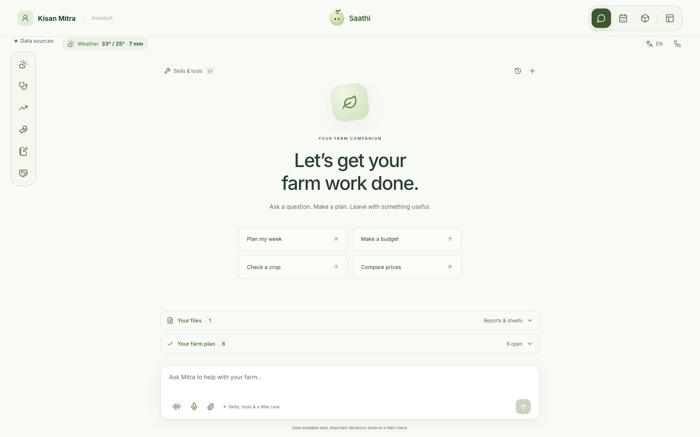
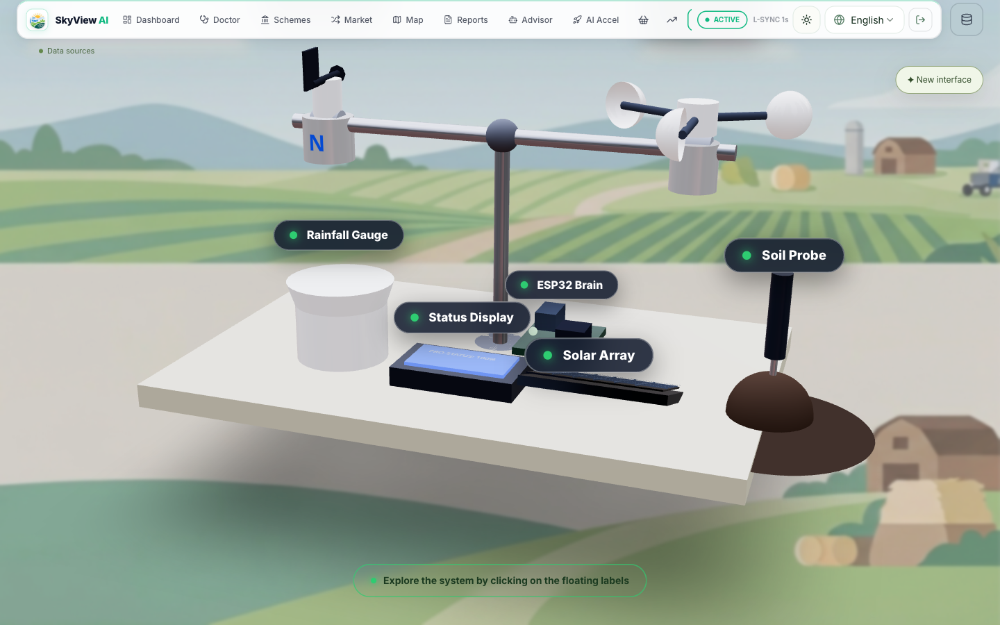
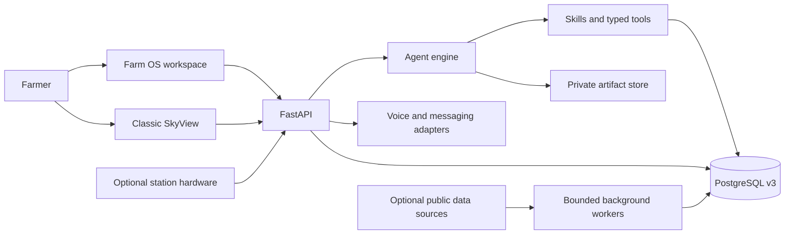

<div align="center">

# 🌱 Kisan Mitra Farm OS

### **An agentic workspace for the whole farm**

*One conversation. Every field, forecast, record, market and next step in reach.*

**Built by init.io for the AI Builder Cup**

[](frontend/)
[](skyview/)
[](data_platform/v3/)
[](frontend/src/components/)
[](LICENSE)

</div>

---

Kisan Mitra joins two ways of working. **Classic SkyView** keeps focused dashboards and specialist screens. The **new Farm OS workspace** brings chat, Saathi, weather, the 3D farm station, crop care, markets, an exchange, calendar and a notebook into one coherent flow. A farmer can start with a question, inspect what the assistant checked, provide a missing detail, review a proposed change and find the finished record or file where it belongs.

<table>
<tr><th>Farm OS · the agent workspace</th><th>Classic SkyView · the visual station</th></tr>
<tr><td></td><td></td></tr>
<tr><th>Weather · a regional outlook</th><th>Notebook · a farm story</th></tr>
<tr><td></td><td></td></tr>
</table>

> [!NOTE]
> This private competition repository includes a reproducible local farm dataset. Seeded people, observations and price scenarios are fictional. External weather is regional model data, not a sensor reading from a field. Source and date context prevent a useful prototype from implying a verified market trade, diagnosis or hardware action.

## 🗺️ Explore

- [The experience](#-the-experience)
- [Two interfaces, one farm](#-two-interfaces-one-farm)
- [How the agent gets work done](#-how-the-agent-gets-work-done)
- [Farm features](#-farm-features)
- [System architecture](#-system-architecture)
- [Data, freshness and trust](#-data-freshness-and-trust)
- [Run locally](#-run-locally)
- [Verify the build](#-verify-the-build)
- [Repository map](#-repository-map)

## 🌾 The experience

```text
Ask naturally ──► Mitra understands the farm ──► Tools gather dated evidence
      ▲                                           │
      │                                           ▼
Answer a question ◄── Missing detail?      A plan, chart or file appears in chat
      │                                           │
      └──────────── Review a change ◄───────────┘
                         │
                         ▼
              Notebook · Calendar · Farm records
```

The assistant is a working surface. It can read owned farm context, use a named skill and typed tool, show concise progress, ask one relevant question at a time, and create a downloadable document or spreadsheet. Changes to farm records require review. The same records then appear in the notebook, calendar and relevant feature screens.

**Saathi** adds a lighter, proactive layer. It prepares contextual suggestions for crop follow-up, exchange and farm records; each opens to a preview and can be edited or approved before it is saved. Saathi can surface useful work, but cannot silently publish a listing, message another farmer, file an application or operate a device.

## 🪟 Two interfaces, one farm

| | Farm OS workspace | Classic SkyView |
| --- | --- | --- |
| **Entry** | Unified `/workspace` with icon navigation and page-aware help | Focused routes including `/overview`, `/advisor`, `/mandi`, `/crop-doctor`, `/marketplace` and `/reports` |
| **Farm view** | Interactive Three.js station and movable helper | Telemetry and digital-twin dashboards |
| **Decisions** | Conversational work with reviewable actions, Saathi suggestions and files in chat | Specialist advisor, crop, market and reporting flows |
| **Records** | Spiral notebook, calendar, profile and exchange trail | Familiar dashboard and dedicated feature pages |

Both interfaces use the same API and farmer-scoped PostgreSQL records. Switching views changes presentation, not the farm or its data.

## 🤖 How the agent gets work done

The skill catalogue covers crop scouting, seasonal planning, weather, mandi prices, field checks, irrigation, budgets, sale planning, programme checklists, soil-report review, shared work, service plans and farm records. Document, spreadsheet and presentation skills generate local artifacts. A research skill can retrieve public information for questions needing current evidence.

| Step | What the farmer sees | What the system does |
| --- | --- | --- |
| **Understand** | The original question stays in chat, in the language used | Infer the task and carry owner-scoped farm context into the run |
| **Investigate** | Brief tool progress and results | Read dated records, references, weather or market series through typed tools |
| **Clarify** | A compact, one-question-at-a-time card | Ask only for inputs missing from the request and saved context |
| **Produce** | An answer, chart or previewable DOCX, PDF, XLSX, CSV or PPTX | Render an owned artifact and retain it for later access |
| **Act** | A concrete approval card | Execute a validated, replay-safe farm-record change after review |
| **Remember** | Previous conversations and saved work | Compact older context without losing the work trail |

Text and voice share the assistant workflow. Live voice uses turn-based transcription, an agent response and spoken playback; microphone and provider configuration are required. Replies can follow Indian-language scripts or Hinglish used in a question, with the selected interface language as fallback. Provider coverage and pronunciation vary by language.

## 🧭 Farm features

### 🌿 Crop care and seasonal decisions

Crop Doctor accepts an image for a cautious assessment and turns observations into follow-up work. Seasonal planning combines crop and location with available reference context; missing local data need not prevent a clearly conditional plan. The notebook keeps fields, crop cycles, observations, costs and work together as a usable farm journal.

### ☀️ Weather and the visual station

The weather workspace brings current conditions, hourly and longer outlooks, rain, wind and air quality into a time-aware scene. City selection lets a farmer compare places; a city forecast is never treated as a measurement on the farm. The interactive Three.js station shows readings and device context, with a page-aware assistant close to the model. Live sensor values require connected hardware and ingestion.

### 📈 Markets and exchange

Mandi exploration filters by crop and place, compares dated series and renders price history with market, variety, unit and source in view. The exchange follows a resource from discovery and fit to discussion and handover. It supports private coordination and reviewable offers; a match is not a booking or payment.

### 📔 Calendar, files and profile

Plans become dated tasks the farmer can inspect and edit. The spiral notebook makes records feel like a single farm story. Generated reports and sheets appear as preview cards in chat and can be downloaded. Profile details connect location, crops and preferences to the tools that need them.

### 📞 Channels beyond the browser

The codebase includes voice and WhatsApp adapters for text, audio and media, plus a Flutter companion and hardware experiments. External delivery, device operation and provider-backed AI require configuration; the local web experience is the primary demo path.

## 🏗️ System architecture



React, TypeScript and Vite serve both interfaces. FastAPI handles authenticated farm routes, assistant runs, media and adapters. PostgreSQL holds farmer-scoped records, conversations, market series and source metadata. Background workers refresh external context with leases, retries and freshness checks. Client caches warm useful reads and invalidate after writes without treating stale data as current.

## 🧬 Data, freshness and trust

The local platform provisions 400 fictional farmer profiles across India, crop and disease references, named market directories, crop cycles, field records, exchange resources and dated planning series. Historical observations, generated practice records and future scenarios have separate meanings. A future scenario is never shown as a historical mandi quote. The source catalog records integration status, provenance and refresh expectations.

Tools keep farmer ownership at API and storage layers. Uploaded files and generated artifacts are private to their owner. A proposed write is inspectable. Source-backed answers should carry date and origin; unavailable live data remains unavailable instead of being silently fabricated.

Read [data-platform operations](data_platform/v3/OPERATIONS.md), [source connectors](data_platform/v3/CONNECTORS.md) and [architecture notes](docs/architecture.md) for implementation details.

## 🚀 Run locally

Use Python 3.12, Node.js, npm and Docker. First setup creates local PostgreSQL and ignored runtime credentials. Keep API keys in local environment files. Keys are needed for corresponding AI, voice and outbound messaging flows.

```bash
python3 -m venv .venv
.venv/bin/pip install -r infra/requirements.txt
cd frontend && npm ci && cd ..

# Fresh installation: generate and provision local data once.
.venv/bin/python data_platform/v3/seed_demo.py --output /absolute/path/to/seed
.venv/bin/python data_platform/v3/provision.py --seed-dir /absolute/path/to/seed

# Later runs reuse the retained database and start both services.
.venv/bin/python data_platform/v3/local.py
```

Open [Farm OS](http://127.0.0.1:5173/workspace) or [Classic SkyView](http://127.0.0.1:5173/overview). The unified API listens on `http://127.0.0.1:8001`; `/health` reports database status. `local.py` does not reseed on every start. The [operations guide](data_platform/v3/OPERATIONS.md) covers provider setup and a dedicated test database.

## 🧪 Verify the build

```bash
.venv/bin/python data_platform/v3/check_local.py
.venv/bin/python data_platform/v3/test_backend.py
cd frontend
npx tsc --noEmit -p tsconfig.app.json
npx vitest run
npm run build
```

Database-backed tests use a separately prepared test database; never aim the test wrapper at populated farm storage. This repository does not include a deployment pipeline yet.

## 📁 Repository map

| Path | Responsibility |
| --- | --- |
| [`frontend/`](frontend/) | Classic screens, Farm OS workspace, visual station and client state |
| [`skyview/assistant/`](skyview/assistant/) | Agent loop, skills, memory, tools, research and artifacts |
| [`skyview/api/`](skyview/api/) | Farm, assistant, weather, voice and integration routes |
| [`skyview/data/v3/`](skyview/data/v3/) | Repositories, ingestion and background workers |
| [`data_platform/v3/`](data_platform/v3/) | Schema, source catalog, provisioning and local checks |
| [`tests/`](tests/) | Backend behavior and integration coverage |
| [`hardware/`](hardware/) | Device and acceleration experiments |
| [`skyview_flutter_app/`](skyview_flutter_app/) | Companion mobile application source |
| [`docs/`](docs/) | Architecture and feature notes |

## 🤝 Contributing

This repository stays private until the AI Builder Cup submission. The intended open-source workflow is focused issues, small reviewable changes, accessible design and meaningful tests. Source connectors should document licensing, refresh cadence and provenance. Keep credentials, generated databases and private farm files out of Git. See [CONTRIBUTING.md](CONTRIBUTING.md).

<div align="center">

**Built for a farmer to leave with something done.**

**init.io · AI Builder Cup**

</div>
