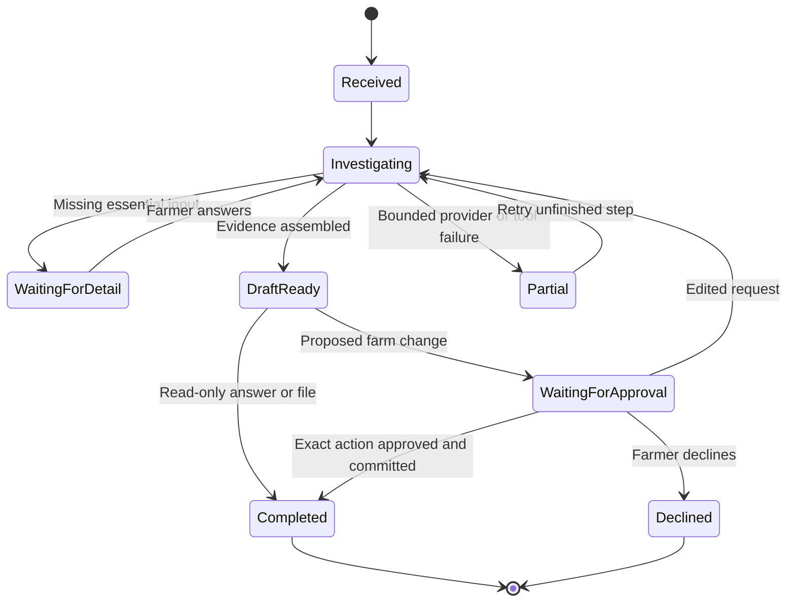
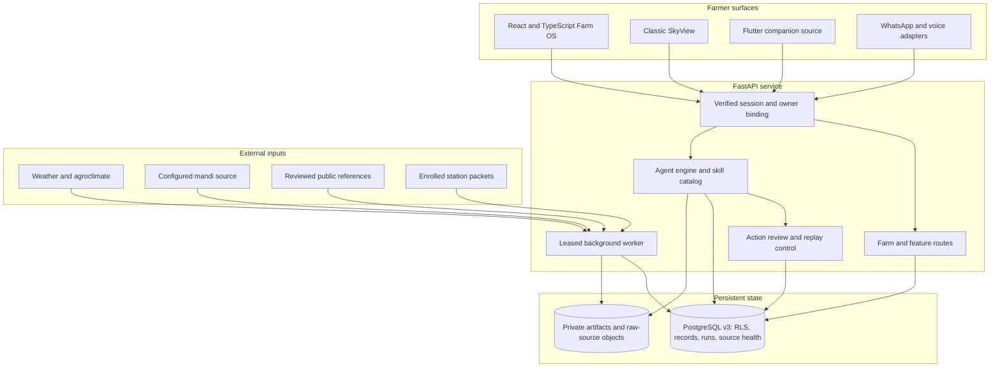
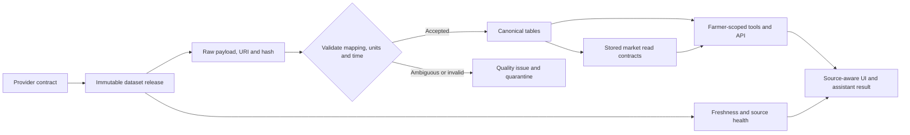
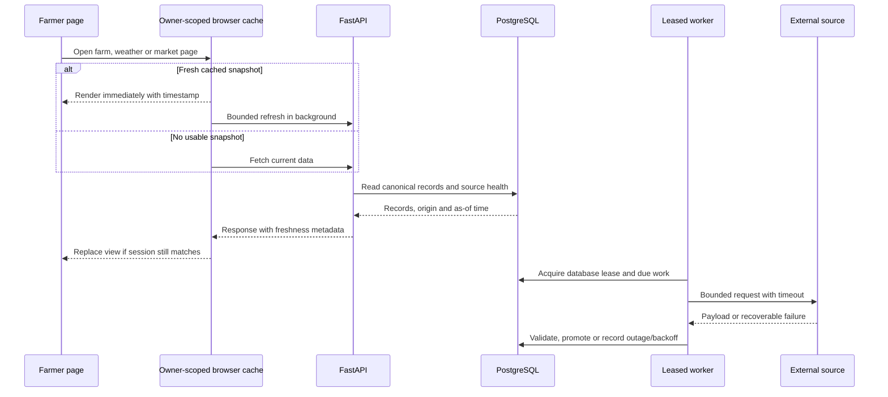

<div align="center">

# Kisan Mitra Farm OS

### A working companion for the whole farm

**Ask in your language. Understand the evidence. Approve the work. Find it where it belongs.**

Built by **init.io** for the **AI Builder Cup**

[Farm OS workspace](frontend/src/components/assistant/) · [Agent runtime](skyview/assistant/) · [Data platform](data_platform/v3/) · [API](skyview/api/) · [Architecture](docs/architecture.md)

</div>

Kisan Mitra combines a conversational farm workspace with the original SkyView dashboards. The assistant can investigate a question, ask for missing detail, use farm-specific tools, prepare a plan or file, pause for review before changing records, and carry the finished result into the notebook, calendar, exchange or another relevant screen. **Saathi** prepares context-aware suggestions in the background so useful next steps can be reviewed even before a farmer starts a conversation.

This is a complete local application, with a React/Three.js frontend, FastAPI service, PostgreSQL data platform, bounded background ingestion, voice and WhatsApp adapters, and a Docker development stack. External observations retain their source and date, and the assistant keeps suggested actions distinct from completed work.

### Farm OS in action

<p align="center"></p>
<p align="center"><sub>Mitra reads saved work and the weather outlook, shows each step, and turns the evidence into a prioritized checklist.</sub></p>

<table>
<tr><th>Interactive farm station</th><th>Weather for the farmer's location</th></tr>
<tr><td></td><td></td></tr>
<tr><th>Work calendar</th><th>Farm notebook</th></tr>
<tr><td></td><td></td></tr>
<tr><th>Farmer exchange</th><th>Farmer profile</th></tr>
<tr><td></td><td></td></tr>
</table>

### Inside the assistant

<table>
<tr><th>A task drafted for review</th><th>A response in Hindi</th></tr>
<tr><td></td><td></td></tr>
<tr><th>Skills and tools</th><th>Chart rendered in chat</th></tr>
<tr><td></td><td></td></tr>
</table>

<p align="center"></p>
<p align="center"><sub>A generated PDF stays in the conversation with a partial preview, revision action and private download.</sub></p>

<p align="center"></p>
<p align="center"><sub>Saathi prepares a contextual exchange plan; the farmer can inspect the steps, edit it, approve it, or dismiss it.</sub></p>

## Contents

- [The product](#the-product)
- [The agentic workflow](#the-agentic-workflow)
- [Feature map](#feature-map)
- [Architecture](#architecture)
- [Data platform and SQL](#data-platform-and-sql)
- [Caching and background work](#caching-and-background-work)
- [Security and trust boundaries](#security-and-trust-boundaries)
- [Run locally](#run-locally)
- [Run with Docker](#run-with-docker)
- [Verification](#verification)
- [GCP deployment handoff](#gcp-deployment-handoff)
- [Repository guide](#repository-guide)

## The product

### Two interfaces, one farm

| Experience | What it is for | Entry |
| --- | --- | --- |
| **Farm OS** | A quieter workspace: chat, calendar, station, weather, crop care, markets, exchange, shared work, profile and notebook within one shell. Contextual help stays close to the current page. | `/workspace` |
| **Classic SkyView** | Dedicated overview, advisor, crop doctor, mandi, trends, marketplace, maps and reporting screens. Useful for focused inspection and existing workflows. | `/overview` and other classic routes |

Both use the same backend and farmer-scoped records. The switch is a presentation choice; it does not create a second farm account or duplicate data. The 3D farm station uses Three.js and React Three Fiber for visual interaction. Station measurements become real-time only after a device is enrolled, authenticated and sending valid packets; a visual model alone does not imply connected hardware.

### Designed around work, not just answers

A farmer can ask, “How should I plan irrigation and labour this week?”, “Is this leaf spot serious?”, or “Compare nearby rice markets and prepare a sale plan.” The assistant can combine profile, plots, crop cycles, weather, market history, reviewed references and owned records when those sources are available. It can render a dated chart, create a DOCX/PDF/XLSX/CSV/PPTX file, or prepare an editable farm action. A change is only committed after the farmer reviews its exact intent. Finished tasks and records appear in the calendar and notebook, not just buried in chat history.

## The agentic workflow

The runtime exposes **22 skills and 52 typed tools**. Skills are concise, inspectable workflows, not arbitrary prompts hidden from the user. Tool arguments are validated before execution. The model receives only relevant tool schemas for the loaded skills, keeping requests focused and reducing token overhead.

```mermaid
sequenceDiagram
    autonumber
    actor Farmer
    participant UI as Farm OS chat or voice
    participant API as FastAPI session
    participant Agent as Agent engine
    participant Tools as Typed skills and tools
    participant DB as Farmer-scoped PostgreSQL
    participant Files as Private artifact storage
    Farmer->>UI: Natural-language request or voice turn
    UI->>API: Authenticated session and attachments
    API->>Agent: Restore conversation, profile and bounded context
    Agent->>Tools: Select skill; run relevant reads
    Tools->>DB: Source-aware, owner-scoped queries
    DB-->>Tools: Dated records and provenance
    Tools-->>Agent: Bounded evidence and structured results
    opt A required detail is missing
        Agent-->>UI: One focused question
        Farmer->>UI: Answer by text or voice
        UI->>Agent: Resume the same task
    end
    opt A document, sheet or chart is requested
        Agent->>Files: Generate private artifact
        Files-->>UI: Inline preview and owned download
    end
    opt A farm record would change
        Agent-->>UI: Exact action for review
        Farmer->>UI: Approve, edit or decline
        UI->>DB: Validated, replay-safe write after approval
        DB-->>UI: Completed record and notification
    end
    Agent-->>UI: Answer in the request language where supported
```

The planner has bounded rounds and tool calls; it emits progress events rather than leaving a silent spinner. A tool failure should preserve completed files and records and identify the unfinished part. A broad request can become a sequence of reads, a clarifying question, a generated artifact and a reviewed write. The agent never treats its own prose as proof that a booking, payment, government filing, hardware command or outbound message happened.

| Agent layer | Implementation | Farmer-facing result |
| --- | --- | --- |
| **Understanding** | [execution contract](skyview/assistant/execution_contract.py), [engine](skyview/assistant/engine.py), saved profile and farm context | Natural requests do not need tool names or rigid commands. |
| **Skills** | 22 Markdown workflows in [skills](skyview/assistant/skills/) with a versioned runtime catalog | Each skill can be inspected, with its purpose and process visible. |
| **Tools** | 52 validated definitions in [tools.py](skyview/assistant/tools.py) | Weather, markets, fields, records, plans, research, files and more use bounded inputs. |
| **Provider routing** | [provider.py](skyview/assistant/provider.py) rotates configured Groq keys, tracks cooldowns and supports a Gemini fallback | Quota and provider failures are surfaced; credentials stay server-side. |
| **Memory** | [memory.py](skyview/assistant/memory.py), [memory_facts.py](skyview/assistant/memory_facts.py), [v3_store.py](skyview/assistant/v3_store.py) | Conversation history, evidence-linked facts, corrections and bounded compaction survive later turns. |
| **Approval** | Pending actions, argument validation, owner checks and replay receipts | The farmer sees exactly what will change before it changes. |
| **Artifacts** | [artifacts.py](skyview/assistant/artifacts.py) and owned metadata | Partial preview in chat, full private download, later retrieval. |
| **Proactive work** | [companion_plans.py](skyview/assistant/companion_plans.py) and [Saathi UI](frontend/src/components/assistant/CompanionPanel.tsx) | Prepared follow-ups open as compact previews and require review. |

Skills span crop scouting and follow-up; field checks, irrigation, weather and seasonal calendars; mandi comparisons and sale planning; budgets, soil reports, schemes and insurance preparation; shared work, expert handoff, farm records and exchanges; and documents, spreadsheets, presentations and public web research. Public research can supply current context, while owned tools remain bound to the farmer’s session.



### Conversation, language and voice

The chat keeps the farmer’s original wording and can answer in the language or script used in the question, with interface preference as fallback. It supports Indian-language text and Hinglish; model, speech and pronunciation quality vary by provider. Text input, single-turn speech input, spoken answer playback and live voice share the same assistant task path. Live voice is turn-based transcription and speech synthesis, not a continuously listening background microphone. The [voice routes](skyview/api/v3_voice_routes.py) and [speech UI](frontend/src/components/assistant/LiveConversation.tsx) keep microphone permission explicit.

[WhatsApp handling](skyview/assistant/whatsapp.py) supports text, media and voice notes with bounded size, signature checks, media validation and idempotent outbound state. It requires configured Twilio credentials and an explicitly linked identity. It does not automatically message another farmer or publish an exchange offer.

## Feature map

| Area | Farmer experience | Data and action path |
| --- | --- | --- |
| **Farm station** | Interactive 3D layout, selected-device feedback, readings and page-aware helper | Enrolled stations, packet receipts, timestamped telemetry and calibration context. |
| **Weather** | Current conditions, hourly view, longer outlook, rain/wind/air quality and city selection with time-of-day visuals | Regional Open-Meteo forecasts and historical/reanalysis sources, with fetch/observation time and location basis. Weather is a grid forecast, not an in-field measurement. |
| **Crop doctor** | Photo-led assessment, symptoms, follow-up and crop-specific guidance | Uploaded image evidence, disease cases, reviewed crop references and conditional next steps; uncertain diagnosis stays uncertain. |
| **Mandi and trends** | Crop/state/market search, exact dated history, price comparisons and charts | Canonical crop/variety/grade/unit series, market directory, observations, source labels and a separate planning-scenario lane. |
| **Farmer exchange** | Discover resources, draft an offer or need, inspect fit, discuss and confirm handover | Listing and match APIs, consent-aware conversations, exchange states and review before publication. No implied booking or payment. |
| **Shared work** | Coordinate labour, equipment, transport, service requests and group tasks | Owner-scoped service records and group membership rather than informal chat-only promises. |
| **Farm notebook** | Spiral journal with a simpler record view, field observations, plans, costs and Saathi suggestions | Farms, plots, crop cycles, field notes, ledger entries and missions stay searchable and editable. |
| **Calendar** | View dated work beside chat, edit/delete tasks, complete a plan | Owned tasks, task events, reminders and approval-origin audit. |
| **Profile and onboarding** | See and edit location, farms, plots, crop cycles, preferences and station links | Verified session ownership and farmer-scoped PostgreSQL transactions. |
| **Documents and reports** | Preview and export DOCX, PDF, XLSX, CSV and PPTX, with source context | Private file bytes, owned metadata, bounded previews and authorized download. |
| **Saathi** | Contextual prepared cards for follow-up, notebook and exchange; approve or edit inline | Leased preparation jobs, evidence-backed proposals and explicit completion state. |
| **Classic pages** | Dedicated dashboard, advisor, crop doctor, mandi, map, marketplace, trends and reports | Compatibility routes share the canonical v3 backend where implemented. |

## Architecture



The frontend uses React, TypeScript, Vite, React Three Fiber and a bounded owner-scoped client cache. FastAPI exposes both classic compatibility routes and canonical farm routes. The agent has its own run/event/approval lifecycle but reads the same farm records as the pages. PostgreSQL stores operational state, source metadata, task history, conversation events and job leases. Raw payloads and generated files stay outside relational rows, with owned metadata and integrity evidence inside PostgreSQL.

## Data platform and SQL

The v3 platform starts with **75 generated base tables**, additional feature tables from additive runtime SQL, **29 explicit access-path indexes** in the base catalog, RLS policies, constraints and selected monthly partitions. The source catalog documents **26 source categories**, their access conditions and intended refresh contracts. Dataset releases retain source, origin and timestamp metadata throughout ingestion and retrieval.



`data_platform/v3/` now has a deliberate layout:

| Path | Purpose |
| --- | --- |
| [`sql/schema.sql`](data_platform/v3/sql/schema.sql) | Fresh-database PostgreSQL 16 DDL generated from [`build_schema.py`](data_platform/v3/build_schema.py). |
| [`sql/*-runtime.sql`](data_platform/v3/sql/) | Ordered additive feature migrations, role grants and stored functions. [`layout.py`](data_platform/v3/layout.py) is the single migration inventory. |
| [`sql/market-read-runtime.sql`](data_platform/v3/sql/market-read-runtime.sql) | Invoker-rights market history and latest-price functions used by the canonical repository. |
| [`catalog/`](data_platform/v3/catalog/) | Machine-readable schema, source inventory, reviewed references and market directory. |
| [`bootstrap.py`](data_platform/v3/bootstrap.py) | Fresh install or additive migration against an explicitly named PostgreSQL database. |
| [`provision.py`](data_platform/v3/provision.py) | Guarded local Docker database creation with private generated credentials. |
| [`CONNECTORS.md`](data_platform/v3/CONNECTORS.md) / [`OPERATIONS.md`](data_platform/v3/OPERATIONS.md) | Source contracts, worker cadence, isolation rules and operations. |

SQL is deliberately bounded. `sv3_app` reads owner-scoped data; `sv3_writer` receives narrow mutation grants; `sv3_ingest` is reserved for trusted ingestion. The canonical market and station read paths call stored functions rather than embedding their long join/filter queries in the API. Existing feature repositories also contain parameterized SQL, so **the full application is not yet stored-procedure-only**. Replacing every remaining direct query requires explicit function signatures, privilege review and endpoint parity tests; a generic “execute arbitrary SQL” function would erase the security benefit. This is a concrete deployment gate if a strict SP-only policy is required.

The query contract distinguishes an observation date from a fetch date, and both from a forecast issue time. Market series preserve commodity, variety, grade and unit. Historical observations, forecasts and planning projections retain separate origin metadata. A directory-only mandi has a location/name, not an invented quote. Missing source days remain missing.

## Caching and background work



The [browser cache](frontend/src/lib/ultraCache.ts) keeps a bounded set of owner-scoped snapshots, deduplicates concurrent fetches, uses TTLs and refreshes in the background. It warms a few likely routes after login, skips speculative requests on hidden pages, data-saver and slow connections, and clears entries on session change or farm writes. An expired result is not silently promoted as fresh. Owner-specific API responses use `no-store`; public responses use short cache windows where appropriate. Cache speed never overrides source freshness.

The [worker](skyview/data/v3/worker.py) acquires a PostgreSQL advisory lease so multiple API processes do not all run the same recurring jobs. Jobs have bounded requests, source-health state, retry/backoff and separate cadences for station telemetry, dated data rollover, consented regional weather, historical weather and mandi snapshots, reviewed references, Saathi preparation and WhatsApp delivery. Source failures do not manufacture zero rainfall or zero prices. Ingestion retains release hashes, raw-object URIs and quality issues. A forecast cache is regional; private plot coordinates are not sent as-is to public weather providers. Consent to link a farm to a coarse weather grid can be revoked.

## Security and trust boundaries

- **Identity:** The server binds the farmer to a verified session and sets `app.farmer_id` for each database transaction. PostgreSQL row policies and owner foreign keys add a second boundary. Browser input never chooses a database role or arbitrary owner.
- **Credentials:** Provider keys, database passwords, WhatsApp credentials and runtime settings belong in ignored environment files or secret stores. Local database volumes, raw media and generated farm artifacts stay outside Git.
- **Evidence:** Source, origin, observation time and retrieval time travel with a result. Forecasts, reported prices, farmer entries and planning projections retain distinct provenance.
- **Actions:** Read tools can answer; write tools prepare exact approval intent. Idempotency/replay receipts protect retries. Publishing an offer, sending WhatsApp media, submitting a form or controlling hardware requires its own explicit path and acknowledgment.
- **Files:** Uploads are type/size bounded. Generated files have owner-scoped metadata and private bytes; chat shows an excerpt, not unrestricted object storage.
- **Operational boundaries:** Workstation and hosted environments use separate databases. Hosted deployment requires external persistence, secrets and worker scheduling.

## Run locally

The Docker stack runs PostgreSQL 16, the API, background worker and web client together. Optional AI, speech, weather and messaging providers need their own server-side credentials. For a native Python/Node setup, see the [local operation guide](docs/local-setup.md).

```bash
cp .env.docker.example .env.docker
# Set POSTGRES_PASSWORD and V3_APP_PASSWORD in .env.docker.
docker compose --env-file .env.docker up --build
```

Open [Farm OS](http://127.0.0.1:5173/workspace) or [Classic SkyView](http://127.0.0.1:5173/overview). The container stack keeps database and application files in named volumes. The native launcher also preserves existing records across restarts.

## Run with Docker

The root [Compose file](docker-compose.yml) describes the v3 application: PostgreSQL 16, one-time database initialization, FastAPI on the internal network, and an Nginx-served frontend with same-origin API proxying. Set `POSTGRES_PASSWORD` and `V3_APP_PASSWORD` to distinct random URL-safe values.

Visit `http://127.0.0.1:5173/workspace`. The first run installs the guarded schema and initializes the database; later starts apply additive runtime SQL without replacing records. The database and app-file directories are named volumes. `docker compose --env-file .env.docker down` stops containers without deleting volumes. `down --volumes` deletes local data and must be a deliberate reset.

The [backend image](infra/Dockerfile.backend) uses Python 3.12, caches dependencies before copying source, runs as a non-root user and honors `PORT` for a future Cloud Run service. The [frontend image](infra/Dockerfile.frontend) builds from `frontend/package-lock.json` and serves the SPA through [Nginx](infra/nginx.conf). The Docker build context excludes local credentials, test databases, caches, Flutter sources, media captures and other files unrelated to the two images. The Compose password interpolation expects URL-safe values; a hosted deployment should supply a properly encoded `V3_DATABASE_URL` through its secret store.

## Verification

```bash
.venv/bin/python data_platform/v3/test_backend.py
(cd frontend && npx tsc --noEmit -p tsconfig.app.json && npx vitest run && npm run build)
```

Prepare the isolated test database using the [local operation guide](docs/local-setup.md) before running backend checks. The backend wrapper targets its dedicated test database. Test coverage includes owner isolation, agent actions and memory, source ingestion, weather, market joins/filtering, artifact boundaries, voice, exchange and worker behavior. Market function tests exercise the PostgreSQL read paths. Build checks should pass before a deployment image is tagged.

## GCP deployment handoff

The code now has a real backend container, frontend container and external-database bootstrap entry point. The next deployment step still needs explicit infrastructure choices: Cloud SQL PostgreSQL 16 and supported role privileges, Secret Manager for all credentials, Cloud Storage for persistent raw payloads/artifacts, and a service identity for each runtime. Cloud Run’s filesystem is ephemeral; local `/app-data` cannot be treated as durable storage there. Cloud Run instances may scale to zero, so the recurring worker needs a separately scheduled or always-on execution plan; the local API startup loop alone is not a production scheduler. Verify Cloud SQL role creation and RLS grants in the target instance before running `bootstrap.py` on a fresh named database.

Set the API’s `SKYVIEW_DATA_MODE=v3_live`, pass an encoded `V3_DATABASE_URL` securely, configure the frontend API origin and CORS, and run database migrations before traffic. Validate `/health`, owner isolation, file persistence, source refresh and voice/WhatsApp webhooks in staging. No CI/CD workflow or GCP resources are created by this repository yet.

## Repository guide

| Directory | Responsibility |
| --- | --- |
| [`frontend/`](frontend/) | Farm OS and classic screens, Three.js station, chat, voice, export and UI cache. |
| [`skyview/assistant/`](skyview/assistant/) | Agent engine, skill/tool catalog, provider routing, memory, approvals, artifacts and channels. |
| [`skyview/api/`](skyview/api/) | Canonical farm routes, classic compatibility, media, weather, exchange and voice. |
| [`skyview/data/v3/`](skyview/data/v3/) | Connection boundary, repositories, ingestion and leased background worker. |
| [`data_platform/v3/`](data_platform/v3/) | Ordered SQL, catalogs, bootstrap, local provisioning and operations. |
| [`infra/`](infra/) | Backend/frontend images, Nginx and dependency lock points. |
| [`tests/`](tests/) | Backend and database contracts. Frontend component tests live beside components. |
| [`hardware/`](hardware/) and [`mobile/`](mobile/) | Device experiments and companion mobile source; neither is required to run the web stack. |
| [`docs/`](docs/) | Architecture and feature notes. |

The project is private until submission. Contributions should keep farmer ownership, source provenance, replay safety and accessible language flows intact. See [CONTRIBUTING.md](CONTRIBUTING.md) and [LICENSE](LICENSE).

<div align="center"><strong>init.io · Build a farm decision into finished, reviewable work.</strong></div>
