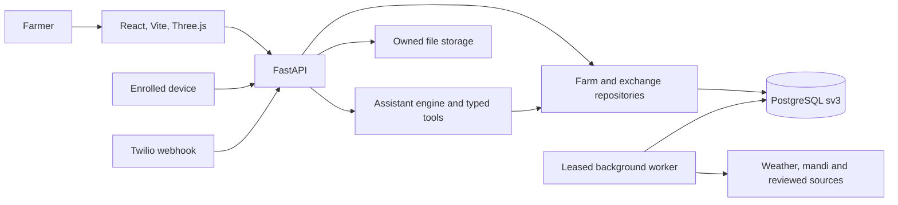

# Architecture

Kisan Mitra runs a React/TypeScript web client, a FastAPI service, and a PostgreSQL 16 data platform. `frontend/src/App.tsx` owns both the Farm OS and classic routes. `skyview/main.py` selects the canonical v3 router set when `SKYVIEW_DATA_MODE` enables v3; otherwise it registers the retained classic routers. The two browser experiences share server-side farm records in the canonical lane.

## Request path

The web app sends an assistant session capability and, in live mode, a verified account token. Server code resolves the farmer identity; client-supplied owner IDs do not select another farmer. Canonical repositories use bound values and set farmer scope on database transactions. PostgreSQL row policies, owner keys and restricted roles provide a second boundary. Public weather and source-health data are handled separately from private farm records.

## Assistant execution

`skyview/assistant/engine.py` restores a bounded conversation, selects relevant schemas from `tools.py`, streams public activity, and executes typed tools. A missing detail pauses the run with a validated question. A write pauses with a review card carrying exact arguments. An approval resumes that same action through an idempotent execution receipt. A prepared plan, file, exchange draft or checklist is distinct from a physical action, external delivery or completed transaction. See [assistant internals](assistant.md).

## Data and source lifecycle

`data_platform/v3/layout.py` defines the ordered base schema and additive migrations. Provider payloads are captured with source and retrieval metadata; validation maps them into canonical tables or records quality failures. A source timeout is recorded as an outage, not a zero reading. Market observations, forecasts and planning projections retain distinct origin and time semantics. The worker in `skyview/data/v3/worker.py` takes a PostgreSQL advisory lease, bounds requests and retries, and can resume after a process restart. See [data model](data-model.md) and [operations](operations.md).

## UI state and files

The browser cache in `frontend/src/lib/ultraCache.ts` deduplicates reads and invalidates owner-scoped entries after writes or a session switch. Protected API responses use `no-store`; the cache is a responsiveness layer rather than an authority. Generated DOCX, PDF, XLSX, CSV and PPTX bytes live outside database rows. Owned metadata, checksums and bounded chat previews remain in PostgreSQL. Files need database and object-byte backups together.

## Runtime boundaries

The Docker stack includes PostgreSQL, one-time schema initialization, the API and an Nginx frontend. A hosted service needs managed PostgreSQL, persistent file storage, secrets, HTTPS identity and a separately scheduled worker. The repository does not contain a deployment workflow. The Flutter project in `mobile/` is the phone client for the same assistant session and farm routes ([mobile guide](mobile/README.md)); no APK is tracked.
